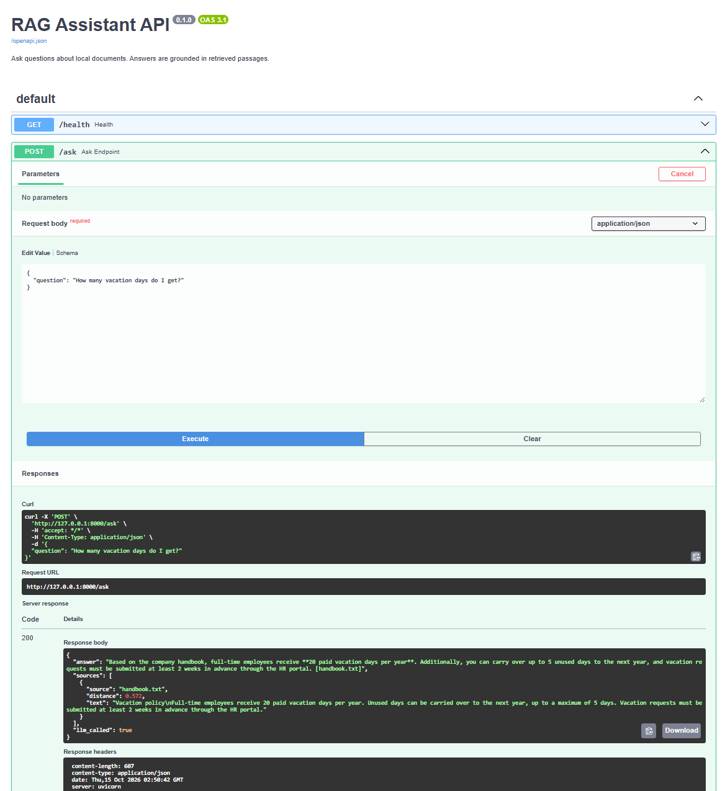

# RAG Assistant

A question-answering assistant over your own text documents, available as a command-line tool and as a REST API (FastAPI, Docker).
It retrieves the most relevant passages with semantic search and asks Claude
to answer **only** from them, citing the source file. If the documents do not
contain the answer, it says so instead of making something up.

## How it works

```
docs/*.txt -> split into chunks -> embeddings -> ChromaDB (local, persistent)
                                                      |
question -> embedding -> top-3 nearest chunks -> distance threshold
                                                      |
                              Claude (answers only from retrieved context)
```

- **Chunking:** paragraph-aware, up to 250 characters per chunk
- **Embeddings:** ChromaDB's built-in local model (all-MiniLM-L6-v2), no extra API key
- **Vector store:** ChromaDB, persisted to `chroma_db/`
- **Generation:** Claude via the Anthropic API
- **Two layers of protection against hallucinations:**
  1. Distance threshold: if no chunk is close enough, the LLM is not called at all
  2. System prompt: the model must answer only from context or reply that it could not find the answer

## Setup

```bash
pip install -r requirements.txt
cp .env.example .env        # then put your Anthropic API key into .env
                            # Windows (cmd): copy .env.example .env
```

Put your `.txt` documents into the `docs/` folder (a sample `handbook.txt` is included).

## Usage

```bash
python rag_assistant.py
```

```
Question: How many vacation days do I get?
Answer: Full-time employees receive 20 paid vacation days per year. [handbook.txt]
```

## REST API

```bash
python -m uvicorn api:app --reload
```

Open http://127.0.0.1:8000/docs for the interactive Swagger UI.



| Method | Path      | Description                                |
| ------ | --------- | ------------------------------------------ |
| GET    | `/health` | Liveness check                             |
| POST   | `/ask`    | Ask a question about the indexed documents |

Request:

```json
{ "question": "How many vacation days do I get?" }
```

Response:

```json
{
  "answer": "Full-time employees receive 20 paid vacation days per year. [handbook.txt]",
  "sources": [{ "source": "handbook.txt", "distance": 0.572, "text": "..." }],
  "llm_called": true
}
```

Behavior:

- Input is validated (3-500 characters); invalid requests return `422`
- If no chunk is close enough, `llm_called` is `false` and the LLM is never called
- If the LLM provider fails, the API returns `502` instead of an unhandled `500`

## Evaluation

`eval_retrieval.py` checks retrieval quality without calling the LLM (free and deterministic).
Each test case says whether the answer should be found in the documents.

| Question                                     | Best distance | Answer in docs? | Result           |
| -------------------------------------------- | ------------- | --------------- | ---------------- |
| How many vacation days do I get?             | 0.572         | yes             | OK               |
| Can I carry over unused vacation days?       | 0.651         | yes             | OK               |
| Can I work from home on Fridays?             | 0.985         | yes             | OK               |
| Do I need approval to buy a $150 keyboard?   | 1.383         | yes             | OK               |
| What should I do if I lose my laptop?        | 1.196         | yes             | OK               |
| What is the CEO's salary?                    | 1.757         | no              | OK               |
| What is the company's parental leave policy? | 1.253         | no              | FAIL (see below) |
| Who won the football game yesterday?         | 1.835         | no              | OK               |

**Findings**

- Smaller chunks improved retrieval: the vacation question went from distance 0.812 (500-char chunks) to 0.572 (250-char chunks).
- A single distance threshold cannot separate every case: "parental leave" is semantically close to "vacation" and scores better than the valid "keyboard" question.
  The threshold (1.4) therefore only filters clearly unrelated questions; the system prompt handles the borderline ones.

## Tests

```bash
pip install -r requirements-dev.txt
python -m pytest -v
```

The suite covers health check, request validation (422), the no-LLM path for out-of-scope questions, and the happy path with a mocked Claude client, so tests run offline and cost nothing.

## Run with Docker

```bash
cp .env.example .env   # add your ANTHROPIC_API_KEY
docker compose up --build
```

The API is available at http://localhost:8000/docs. The vector store and the embedding model cache are kept in named volumes, documents in `docs/` are mounted read-only, and the API key is passed at runtime and never baked into the image.

## Limitations and next steps

- Only `.txt` files; PDF/DOCX ingestion is not implemented
- Tiny sample corpus, so distance values are noisy
- No authentication or rate limiting on the API (intended as a local/demo service)
- Documents are re-indexed on every startup; there is no incremental update or deletion
- Planned: PDF ingestion, reranking, answer-level evaluation (Ragas), pgvector backend
